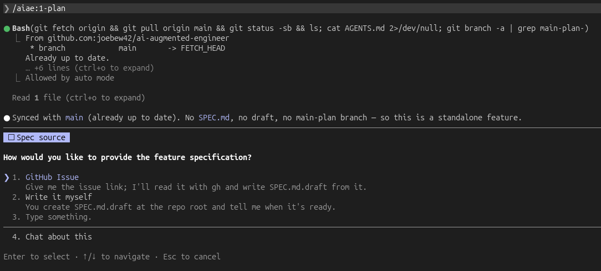
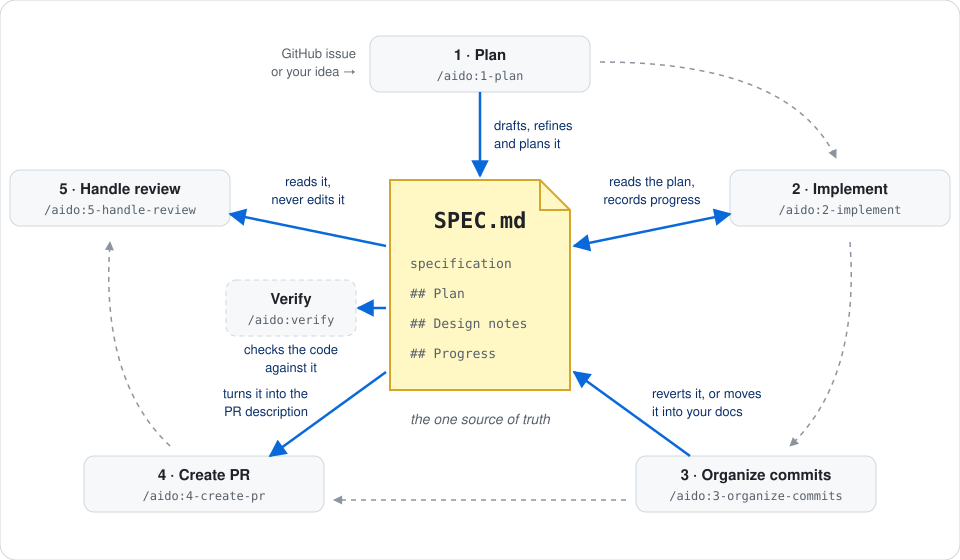

# aido 🥋

**AI does, you decide.**

Hand Claude Code the whole feature: the spec, the tests, the code, the commits and the pull request.
aido stops at every decision that matters and asks you, so what gets built stays your call. It works
with any stack.

```
/plugin marketplace add joebew42/aido
/plugin install aido@aido
/aido:1-plan
```

Every skill is available as `/aido:<skill>`.




## Your first feature

| Step | Skill | What it does |
| --- | --- | --- |
| 1 | `/aido:1-plan` | Specifies and plans the feature in `SPEC.md` |
| 2 | `/aido:2-implement` | Builds the feature |
| 3 | `/aido:3-organize-commits` | Cleans up the commit history |
| 4 | `/aido:4-create-pr` | Creates the pull request |
| 5 | `/aido:5-handle-review` | Handles the review feedback |

`/aido:1-plan` drafts the specification in `SPEC.md.draft` (from a GitHub issue, one you write, or a
conversation with you), refines it with you until you approve it as `SPEC.md`, plans the work,
creates the branch, and offers to move on to implementation. When the change looks small and clear,
it proposes a lighter route: a brief specification and plan that you approve once, without the
enabling refactoring analysis. `/aido:3-organize-commits` asks whether to revert `SPEC.md` (the
default) or keep it in the repository's docs.

## Recommended user settings

The guidelines ask for commits and PRs without AI attribution and for no auto-memory. A plugin
can't set these, so add them to your `~/.claude/settings.json`:

```json
{
  "autoMemoryEnabled": false,
  "attribution": { "commit": "", "pr": "" }
}
```

The plugin's hooks also block commit messages with `Co-Authored-By` trailers and writes to Claude's
memory directory.

## Why aido: AI-Augmented Engineering

An AI-augmented engineer uses an AI agent to do more of the work, without handing over the
judgement. The agent explores the code, drafts the specification, writes the tests and the code,
and shapes the commits and the pull request. The engineer decides what gets built, approves every
step that matters, and stays accountable for the result.

`aido` stands for "AI do" and echoes `sudo`: the agent does the work, on your say-so. It is a
workflow for working that way, and each of its practices keeps that split in place:

- **The engineer decides, the agent proposes.** Each stage ends with an explicit approval — the
  specification, the plan, the commit structure, the pull request — and the agent asks instead of
  guessing whenever a choice is yours.
- **Specification before code.** Every feature starts as a draft that is refined with you into
  `SPEC.md`, then planned. A small, clear change can take a lighter route, with the specification
  and the plan approved together. Implementation only starts from an approved plan.
- **Small, reviewable steps.** Code grows test by test with test-driven development, so each change
  is easy to follow and to stop.
- **Good engineering practices by default.** Clean architecture, deliberate refactoring, focused
  tests and a clean commit history are part of every step, not an afterthought.
- **Your repository's rules come first.** aido brings practices, not conventions. How to
  test, lint, name or structure code comes from your repository — first from its `CLAUDE.md` and
  `AGENTS.md`, then from the code itself.

To learn more about the wider field, see
[AI-Augmented Software Engineering](https://www.sei.cmu.edu/ai-augmented-software-engineering/) at
Carnegie Mellon's Software Engineering Institute.

## How the workflow works

### The specification is at the center

Every stage works from one file, `SPEC.md`. Planning writes the specification, the plan and the
design notes into it. Implementation reads the plan and records its progress there. The pull
request description is written from it, and review feedback is checked against it.



Every specification has the same shape. **Context** says why the change is needed, **Intent** what
it must achieve, **Out of scope** what it leaves out, and **Acceptance criteria** — numbered `AC1`,
`AC2`, … — how you will know it is done. The specification says what and why; how belongs to the
plan that planning adds below it, followed by the progress that implementation records.

### Acceptance criteria are checked at every stage

The acceptance criteria are what verifies that the change does what the specification asks, not
just what the plan lists:

- **planning** proposes them when the draft has none, and every plan item names the criteria it
  serves — none is left without one
- **implementation** writes each criterion's acceptance test first and keeps it red as the goal
  post while the code behind it is built test-driven. Before it calls the feature done, it checks
  every criterion: a test that covers it, or — for criteria only a person can judge, marked
  `(manual)` — your confirmation. When one is not met, you choose to implement it, change it, or
  defer it
- **the pull request** pre-flight review checks the diff against the criteria, and any deferred
  criterion is named in the description

### You stay in the loop

The agent does the work, but it stops before every decision that matters: it does not approve the
specification, choose a refactoring that reaches into another module, rewrite history or push
without you. The only way past these checkpoints is to deliberately run the workflow fully
unsupervised. The diagram at the top of this page shows where it stops at each stage.

For example, when you run `/aido:1-plan`, it stops to ask where the specification comes from: a
GitHub issue it turns into a draft, a draft you write yourself, or a conversation in which it
interviews you and writes the draft. The screenshot at the top of this page shows that question.

## Skills

### Single-phase feature

| Skill | What it does |
| --- | --- |
| `/aido:1-plan` | draft, refine and plan a feature into `SPEC.md` |
| `/aido:2-implement` | implement the feature with TDD |
| `/aido:3-organize-commits` | organize the commit history |
| `/aido:4-create-pr` | create a pull request |
| `/aido:5-handle-review` | handle PR review feedback |

### Multi-phase feature

| Skill | What it does |
| --- | --- |
| `/aido:multi-phase-spec-pr` | create the specification tracking PR |
| `/aido:multi-phase-switch` | switch to the main plan branch |
| `/aido:multi-phase-sync` | sync the main plan with progress |

### Utilities

| Skill | What it does |
| --- | --- |
| `/aido:resolve-migration-conflict` | resolve database migration conflicts after a rebase, with any migration tool |
| `/aido:pr-review` | review a PR from a reviewer's perspective (summary, focus areas, safety assessment) |
| `/aido:stabilize` | take over a PR, remote branch, or local changes made outside this workflow |
| `/aido:map-architecture` | build or update a slim index of the repo's domain areas and their building blocks |
| `/aido:assess-architecture` | assess the architecture area by area and open GitHub issues for the refactorings you pick |

## Other ways to use it

### A multi-phase feature

1. Write the overall feature specification in `SPEC.md.draft`
2. `/aido:multi-phase-spec-pr` — creates the main tracking PR
3. For each phase (or set of parallel phases):
   - `/aido:1-plan` — plans the phase, and offers parallel worktrees for independent phases
   - `/aido:2-implement`, `/aido:3-organize-commits`, `/aido:4-create-pr`
   - `/aido:multi-phase-sync` — updates the main plan and starts the next phase

### Taking over someone else's work

1. `/aido:stabilize`, pointed at the PR, remote branch, or local changes
2. Choose whether to reimplement from scratch or carry the original changes over and adjust them
3. Approve the plan it writes into `SPEC.md`
4. Continue with `/aido:2-implement`, `/aido:3-organize-commits` and `/aido:4-create-pr`

### A migration conflict after a rebase

Run `/aido:resolve-migration-conflict` when another PR's migration was merged while yours was open.

## Guidelines

The skills load these from `plugins/aido/guidelines/`:

| Guideline | What it covers |
| --- | --- |
| `git-workflow.md` | commit conventions, the per-commit gate, branching strategy, GitHub CLI usage |
| `code-standards.md` | design principles, code quality, comments, interaction style |
| `tdd.md` | the red-green-refactor cycle and how to match step size to uncertainty |
| `testing-principles.md` | test structure, collaboration tests, flaky-test prevention |
| `project-conventions.md` | how the skills find the host repository's own conventions in its `CLAUDE.md` and `AGENTS.md` |
| `specification.md` | the specification file and its structure, including acceptance criteria |
| `systemic-refactoring.md` | when and how to look beyond the changed lines, read when a design check runs |
| `evolving-guidelines.md` | how to propose conventions to the host repository, read after a PR or phase |
| `pr-roadmap.md` | the roadmap format for multi-phase PRs, read when one is written |
