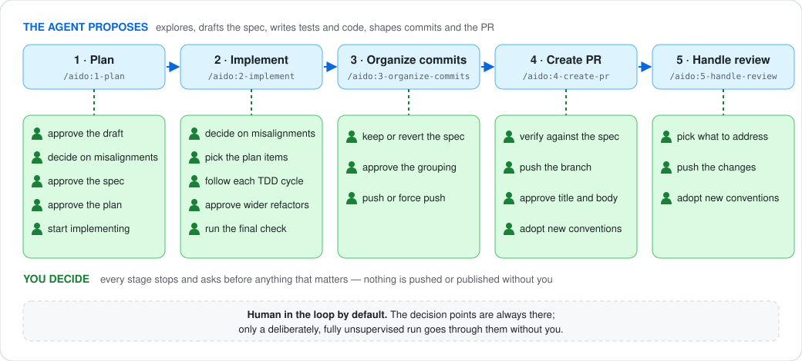
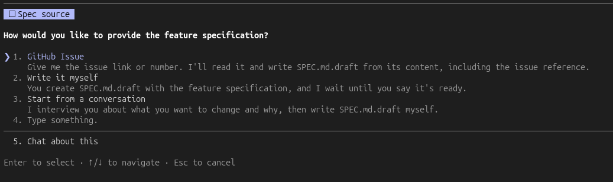

<div align="center">


# aido 🥋

### AI does, you decide.

**A spec-driven, test-driven engineering workflow for Claude Code.**

Hand Claude Code the whole feature — the spec, tests, code, commits, and pull request — while
**you stay in charge of every decision that matters**.

Works with any stack.

[Get started](#get-started) · [How it works](#how-it-works) · [Skills](#skills) ·
[Why aido?](#why-aido)

</div>

---

## Get started

Install the plugin in Claude Code, then start planning your first feature:

```text
/plugin marketplace add joebew42/aido
/plugin install aido@aido
/aido:1-plan
```

Every skill is available as `/aido:<skill>`.

### Your first feature, in five steps

| | Skill | What happens |
| :--: | --- | --- |
| **01** | `/aido:1-plan` | Draft, refine, and approve the specification and implementation plan in `SPEC.md`. |
| **02** | `/aido:2-implement` | Build the feature test by test, checking progress against acceptance criteria. |
| **03** | `/aido:3-organize-commits` | Turn the work into a clean, reviewable commit history. |
| **04** | `/aido:4-create-pr` | Offer verification, push with your approval, and create the pull request. |
| **05** | `/aido:5-handle-review` | Evaluate review feedback and address the items you choose. |

> **You approve the important decisions.** aido proposes; it does not silently decide what to
> build, rewrite history, or push on your behalf.

<div align="center">
  
</div>

### What planning looks like

Start from a GitHub issue, your own `SPEC.md.draft`, or a conversation in which aido interviews you
and drafts the specification.

<div align="center">
  
</div>

`/aido:1-plan` checks the draft against your repository, refines it with you, and only turns it into
`SPEC.md` after approval. It then plans the work, creates a branch, and moves into implementation if
you chose to. A full plan stops for three approvals, of the draft, the specification and the plan,
each settling the choice that follows it, on top of any questions about what to build. For a small,
clear change, it can propose a lighter route: a brief specification and plan approved together,
without the enabling-refactoring analysis.

Later, `/aido:3-organize-commits` asks whether to revert `SPEC.md` (the default) or keep it in the
repository docs. `/aido:4-create-pr` offers verification before pushing and can open GitHub issues
for deferred acceptance criteria you select.

### Recommended Claude Code settings

The guidelines request commits and PRs without AI attribution and no auto-memory. A plugin cannot
set those preferences itself, so add the following to `~/.claude/settings.json`:

```json
{
  "autoMemoryEnabled": false,
  "attribution": { "commit": "", "pr": "" }
}
```

### What the plugin's hooks enforce

| Hook | Default | Turn it off |
| --- | --- | --- |
| Ask for your approval before every `git push` | on | not available |
| Block commit messages containing `Co-Authored-By` trailers | on | `git config aido.allowCommitAttribution true` |
| Block writes to Claude's memory directory | on | `git config aido.allowMemoryWrites true` |

Each opt-out applies to the current repository; add `--global` to apply it everywhere. These are
your settings to make: the skills never set them.

---

## Why aido?

**AI-augmented engineering means delegating work without delegating judgement.**

The agent explores the codebase, proposes a specification, writes tests and implementation, and
prepares commits and pull requests. The engineer decides what gets built, approves consequential
choices, and remains accountable for the result.

The name **aido** means **"AI do"** and echoes `sudo`: the agent acts on your say-so.

- **The engineer decides; the agent proposes.** The specification, plan, commit grouping, pushes,
  and pull request pass through explicit checkpoints.
- **Specification before code.** Work starts from an approved specification and plan, with a lighter
  route available for small changes.
- **Test-driven, reviewable steps.** Implementation grows through red–green–refactor, in increments
  that are easy to inspect.
- **Engineering practices built in.** Clean architecture, focused tests, deliberate refactoring, and
  a tidy history are part of the workflow.
- **Your repository's conventions win.** aido reads `CLAUDE.md`, `AGENTS.md`, and the codebase
  rather than imposing a new naming, testing, or architecture scheme.

For broader context, see
[AI-Augmented Software Engineering](https://www.sei.cmu.edu/ai-augmented-software-engineering/) from
Carnegie Mellon University's Software Engineering Institute.

---

## How it works

### One specification connects the whole workflow

`SPEC.md` is the shared reference for the feature. Planning writes the specification, design notes,
and plan; implementation records progress; PR creation draws on it; review checks feedback against
it; and `/aido:verify` compares the code with the agreed requirements.

<div align="center">
  
</div>

Each specification identifies **Context** (why), **Intent** (what), **Out of scope** (what not), and
numbered **Acceptance criteria** (`AC1`, `AC2`, …). The specification describes what and why; the
plan describes how; progress notes record what happened.

### Acceptance criteria stay visible

- **Planning** proposes missing criteria and links every plan item to the criteria it serves.
- **Implementation** writes acceptance tests first, keeps them red while developing the supporting
  code with TDD in the mode the plan gives each part, and checks every criterion before completion.
  Criteria requiring human judgement
  are marked `(manual)` and require your confirmation. When a criterion is not met, you choose to
  implement it, change it, or defer it.
- **Verification** checks the criteria again in a fresh context. Deferred criteria appear in the PR
  and can become GitHub issues.

### Uncertainty chooses how each part is built

Every feature item in a plan names its mode and why, so you can challenge the choice before any code
exists. Implementation and commit organization then follow it.

| What's unknown | Mode | How it is built | History |
| --- | --- | --- | --- |
| Nothing: it follows existing code or a known contract | `inside-out` | Test-first, layer by layer | Inside-out, acceptance tests last |
| How the parts fit, or what an interface should be | `outside-in` | Strict TDD, in tracer bullet slices | One group of commits per slice |
| Logic within one unit | `in-unit` | Strict TDD in that unit | As inside-out |

A part is inside-out only if the plan can cite what it conforms to. When the plan proves wrong,
implementation changes the mode, tells you, and records it.

### The repository is part of the conversation

A specification may be internally clear but incompatible with the existing codebase. `/aido:1-plan`
checks for conflicts before approval, and `/aido:2-implement` checks again at the start of each
session in case the default branch has changed.

Significant conflicts include contradictions with `CLAUDE.md` or `AGENTS.md`, crossing architectural
boundaries, or changing behaviour other code depends on. aido explains the conflict, points to the
relevant files, and recommends revising or rejecting the specification. You can still intentionally
proceed; your decision and reasoning are recorded.

### Verify what was agreed, not just what was implemented

Run `/aido:verify` against the current branch or a PR. It runs from a **fresh context**, so the
agent that built the change is not the one judging it, and it changes nothing. It reports each
requirement as **verified**, **insufficient evidence**, or **unmet**, with deviations listed
separately.

Verification requires a test that actually passed during the check or a recorded human confirmation;
progress-note claims are not enough. It also removes the behaviour in a throwaway worktree to confirm
the test fails without it, since the same agent probably wrote both. For a PR without a specification, verification falls back to
the PR description and linked issues and explicitly notes that the evidence is weaker.

`/aido:verify` complements Claude Code's `/code-review`:

| Tool | Question |
| --- | --- |
| `/aido:verify` | **Did we build what we agreed to build?** |
| `/code-review` | **Does the code have defects?** |

### You remain in the loop

The agent stops before decisions that matter: approving a specification, choosing a cross-module
refactoring, rewriting history, or pushing changes. Those gates are only bypassed if you
deliberately run the workflow fully unsupervised.

---

## Skills

### Single-phase feature

| Skill | Purpose |
| --- | --- |
| `/aido:1-plan` | Draft, refine, and plan a feature into `SPEC.md`. |
| `/aido:2-implement` | Implement the feature using TDD. |
| `/aido:3-organize-commits` | Organize the commit history. |
| `/aido:4-create-pr` | Create a pull request. |
| `/aido:5-handle-review` | Handle PR review feedback. |

### Multi-phase feature

| Skill | Purpose |
| --- | --- |
| `/aido:multi-phase-spec-pr` | Create the specification tracking PR. |
| `/aido:multi-phase-switch` | Switch to the main plan branch. |
| `/aido:multi-phase-sync` | Sync the main plan with progress. |

### Utilities

| Skill | Purpose |
| --- | --- |
| `/aido:verify` | Check a branch or PR against the agreed requirements from a fresh context. |
| `/aido:stabilize` | Take over a PR, remote branch, or local changes created outside this workflow. |
| `/aido:map-architecture` | Build or update a slim index of domain areas and building blocks. |
| `/aido:assess-architecture` | Assess architecture area by area and park selected refactoring opportunities, which `/aido:1-plan` offers when a planned change fits them. |
| `/aido:resolve-migration-conflict` | Resolve migration conflicts after a rebase, with any migration tool. |

---

## Other ways to use aido

### Plan a multi-phase feature

1. Write the overall feature specification in `SPEC.md.draft`.
2. Run `/aido:multi-phase-spec-pr` to create the tracking PR.
3. For each phase (or independent phases in parallel), run `/aido:1-plan`, `/aido:2-implement`,
   `/aido:3-organize-commits`, and `/aido:4-create-pr`. Planning can offer parallel worktrees.
4. Run `/aido:multi-phase-sync` to update the main plan and begin the next phase.

### Take over existing work

1. Run `/aido:stabilize` against a PR, remote branch, or local changes.
2. Choose whether to reimplement from scratch or carry the changes over and adjust them.
3. Approve the plan written into `SPEC.md`.
4. Continue with implementation, commit organization, and PR creation.

### Review someone else's PR

Run `/aido:verify <PR number>` to compare it with the agreed requirements, and `/code-review` to
inspect for defects.

### Resolve a migration conflict

Run `/aido:resolve-migration-conflict` when another PR's database migration was merged while yours
was open.

---

## Engineering guidelines

Skills load their guidance from [`plugins/aido/guidelines/`](plugins/aido/guidelines/).

| Guideline | What it covers |
| --- | --- |
| `git-workflow.md` | Commit conventions, per-commit gates, branching, and GitHub CLI usage. |
| `code-standards.md` | Design principles, code quality, comments, and interaction style. |
| `tdd.md` | Red–green–refactor, and the modes that let uncertainty choose step size and direction. |
| `testing-principles.md` | Test structure, collaboration tests, and flaky-test prevention. |
| `project-conventions.md` | Discovering host repository conventions in `CLAUDE.md` and `AGENTS.md`. |
| `specification.md` | Specification structure and acceptance criteria. |
| `repository-alignment.md` | Checking specifications against the repository and handling conflicts. |
| `systemic-refactoring.md` | Looking beyond changed lines when a design check runs. |
| `evolving-guidelines.md` | Proposing conventions back to the host repository after a PR or phase. |
| `pr-roadmap.md` | Roadmap format for multi-phase PRs. |
| `github-issues.md` | Turning selected follow-ups into issues without duplicating open ones. |

---

## Measuring it

Eval cases compare what agents do with and without aido, so a change to a skill can be measured rather
than judged by feel. See [how to run and read them, and the current results](docs/evals.md).

---

<div align="center">

**aido 🥋**

*AI does, you decide.*

</div>
